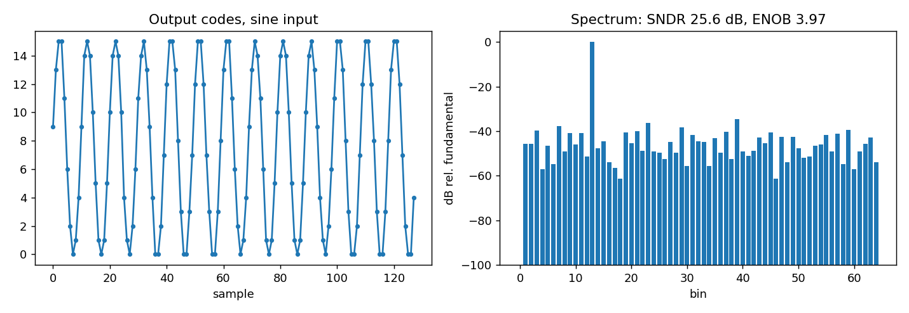

# 4-bit SAR ADC in 180 nm CMOS (GF180MCU): transistor-level design, RTL controller, verification

A 4-bit successive-approximation ADC built from the bottom up: a transistor-level control path (static CMOS gates, master-slave flip-flop, 3-bit FSM), a charge-redistribution capacitor DAC with bottom-plate sampling, and a StrongARM latch comparator, simulated in ngspice with the open GlobalFoundries GF180MCU models. The control logic also exists as verified Verilog that maps onto a Basys 3 FPGA for a bench prototype.

Course project for EEE F376 (Design Project), BITS Pilani, K K Birla Goa Campus, supervised by Ria Rashid. The original Cadence design is not in this repository; everything here runs with open-source tools.

**Status**
- Digital: complete and verified in simulation (RTL, gate-level cross-check, post-synthesis) and by formal proof.
- Analog: complete in simulation (typical, corners, mismatch, dynamic test, MIM capacitors, input-noise sweep, comparator-offset Monte Carlo per corner). The main flow uses open-source GF180MCU models in ngspice; a Cadence Spectre port on the gpdk180 kit reruns the same tests and is reported separately, labelled gpdk180. Layout: the digital core (175 cells) is laid out and LVS-matched, plus the capacitor array and sampling switch; comparator, DAC switches and top-level wiring are not laid out and no parasitics were extracted (see [Not verified](#not-verified)).
- FPGA: Vivado script and constraints are provided but **have not been run**.

## How it works

One conversion takes six clocks (S0 sample, S1..S4 test bit 3 down to bit 0, S5 end of conversion), so 120 ns at the simulated 50 MHz clock (8.33 MS/s).

```
 Vin --[S/H, bottom-plate TG]--> binary cap array (1,2,4,8 C + 1 C) --top plate--> StrongARM comparator + SR latch
                                      ^  bottom plates -> VREF / GND                       |
                                      |                                                    v comp
                      DAC code = R | SET  <----- SAR register (R3..R0) <----- control FSM (S0..S5) -- sample, SET lines, EOC
```

Charge-redistribution decision: `Vin * Ctot > Vref * sum(b_i C_i)`. The top-plate parasitic cancels out of the decision.

## Repository layout

| Path | Contents |
|---|---|
| `rtl/sar_ctrl.v` | 4-bit controller (corrected FSM, SAR register, clock enable) |
| `rtl/sar_ctrl_n.v` | Same controller generalised to N bits |
| `rtl/sar_gates.v` | Gate-level mirror of the transistor-level logic in `spice/cells.sp`, used for cross-checking |
| `rtl/fpga_top.v`, `fpga/` | Basys 3 top level, constraints, batch Vivado script (`build.tcl`, not run) |
| `tb/` | Self-checking testbenches |
| `layout/` | Layout flow on the foundry device generators: 175-cell digital core, standard cells, capacitor array, rule subset, LVS (work in progress) |
| `formal/` | SymbiYosys proofs of the controller (`make formal`) |
| `spice/` | Transistor-level netlists: `cells.sp` (gates, DFF, FSM logic), `adc_130b.sp` (complete converter), FSM variants, generators |
| `scripts/` | Run, Monte Carlo and analysis scripts (ngspice / GF180MCU) |
| `scripts/spectre_*.py` | Spectre / gpdk180 port: netlist translator (`spectre_gen.py`), job runner, raw-file parser and analysis, comparator Monte Carlo |
| `results/` | GF180MCU / ngspice numbers and plots quoted below (JSON, Markdown, PNG) |
| `results/gpdk180/` | Spectre / gpdk180 numbers (JSON, Markdown); never mix these with the GF180 results |

## Results

### Digital (Icarus Verilog, Verilator, Yosys)

| Check | Result |
|---|---|
| `tb_sar`: 65 conversions, 64-step ramp plus 1.30 V | 0 errors; 1.30 V gives 1010 |
| `tb_sar_n` for N = 4, 8, 10 (4 steps per code) | 0 errors; all 16 / 256 / 1024 codes reached |
| RTL vs gate-level mirror of the transistor logic | 20,002 random-comparator cycles, 3,332 conversions: identical outputs |
| Post-synthesis netlist (Yosys generic gates) | 65 conversions, 0 errors |
| Lint (Verilator -Wall) | clean (FPGA top: only an initial-value style warning) |
| Yosys, Artix-7: controller alone | 14 flip-flops, 15 LUTs |
| Yosys, Artix-7: `fpga_top` (adds clock divider and synchroniser) | 26 flip-flops, 17 LUTs, 3 CARRY4 |

Run everything with `make digital`.

**Finding.** The two implementations agree on every reachable state but recover differently from the unused state codes. The RTL sends 110 and 111 straight to S0; the transistor-level equations send 110 to S5 (EOC) and 111 to 100. Both are back in S0 within a few cycles.

**Decoder / EOC glitch study** (GF180MCU, ngspice; `spice/fsm_eocreg.sp`, `scripts/glitch_eoc.py`, `results/eoc_glitch.json`; 18 clock cycles per case). With the report's 10 Mohm loads, the decoded line SET_B1 shows 3 spurious full-rail pulses, up to 140 ps wide. With 20 fF loads the same line only shows a 0.75 V spike, which stays below the logic threshold, and no output pulses. The combinational EOC never glitched. A re-timed EOC (flip-flop on the next-state decode) is also clean but is not required. These runs come from the earlier branch work and were not rerun here.

### Analog (ngspice 47, GF180MCU models, 3.3 V devices run at VDD = 2 V)

| Experiment | Result |
|---|---|
| FSM as built (equations from the reference report) | State sequence 001, 010, 011, 100, 101, 010, ... : S5 goes to S2, S0 and S1 never recur (confirms the report) |
| FSM as built with 1 kOhm on Q_b | Frozen at 111 (confirms the report) |
| FSM corrected (D1 = Q2'(Q1 xor Q0), sync reset) | 000..101, repeating every 120 ns |
| Complete converter, Vin = 1.30 V | code 1010 (10), as in the hand calculation |
| Ramp, 128 steps | 16/16 codes, monotonic, DNL and INL within 0.125 LSB (the step size) |
| Ramp, 256 steps (1/16 LSB resolution) | max abs DNL 0.125 LSB, max abs INL 0.125 LSB, best-fit INL 0.11 LSB; transitions drift down to -0.125 LSB at the top codes (a small gain error) |
| Sine input, 13 cycles in 128 samples (fin 0.85 MHz, fs 8.33 MS/s) | SNDR 25.6 dB, ENOB 3.97, SFDR 34.6 dB; an ideal 4-bit quantiser on the same input gives about 26.0 dB / 4.02 ENOB |
| Comparator offset Monte Carlo, 200 seeds | sigma 7.2 mV, mean -0.3 mV, range -17.5 to +22.5 mV (LSB/2 = 62.5 mV) |
| D flip-flop timing (typical, 20 fF load) | setup 160 ps, hold -160 ps (20 ps scan step), clock-to-Q 280 ps rising / 276 ps falling |

Flip-flop timing note: a hold time of -160 ps with a setup time of +160 ps means the effective sampling instant sits 160 ps before the clock edge and the aperture is near zero (within the 20 ps scan step).




**PVT sweep.** 64-step ramp (0.25 LSB per step) at 11 corner, temperature and supply combinations (Vref and Vcm follow VDD):

| corner | T (C) | VDD (V) | codes seen | monotonic | steps with code error | max code error (LSB) |
|---|---|---|---|---|---|---|
| tt | 27 | 2.0 | 16/16 | yes | 1 | 1 |
| tt | -40 | 2.0 | 16/16 | yes | 1 | 1 |
| tt | 125 | 2.0 | 16/16 | yes | 0 | 0 |
| tt | 27 | 1.8 | 16/16 | yes | 1 | 1 |
| tt | 27 | 2.2 | 16/16 | yes | 0 | 0 |
| ff | 27 | 2.0 | 16/16 | yes | 0 | 0 |
| ss | 27 | 2.0 | 16/16 | yes | 3 | 1 |
| fs | 27 | 2.0 | 16/16 | yes | 3 | 1 |
| sf | 27 | 2.0 | 16/16 | yes | 0 | 0 |
| ss | 125 | 1.8 | 16/16 | yes | 3 | 1 |
| ff | -40 | 2.2 | 16/16 | yes | 2 | 1 |

No corner loses a code or becomes non-monotonic. A "step with code error" means a transition sits more than about 1/8 LSB from ideal; the worst case is three steps in the upper codes. Full table in [`results/pvt_ramp64.md`](results/pvt_ramp64.md).

**Capacitor mismatch** (behavioural Monte Carlo of the binary-weighted array, 5,000 trials per point). The netlist uses ideal capacitors, so the unit-cap sigma below is an **assumption, not a PDK result**:

| unit-cap sigma | worst DNL, median / 99th pct (LSB) | yield, DNL < 0.5 LSB |
|---|---|---|
| 0.5 % | 0.018 / 0.051 | 100 % |
| 1 % | 0.035 / 0.098 | 100 % |
| 2 % | 0.070 / 0.203 | 100 % |
| 5 % | 0.172 / 0.488 | 99.1 % |

At 4 bits, capacitor matching is not the limiting error; comparator offset and the gain drift above matter more.

### Formal proof of the controller

The simulations above test chosen stimuli. The proofs in `formal/` (SymbiYosys, Z3 and ABC PDR) cover every input sequence. Each runs as bounded model checking to depth 40 and as an unbounded proof:

| Check | What is proven | Result |
|---|---|---|
| `ctrl` | Only states S0..S5 are reachable (110 and 111 never occur); `sample` and `eoc` are never high together; exactly one SET line at a time; state steps S0 to S5 and back to S0 on each clock enable; reset clears the state and registers; at S5 the register holds exactly the four comparator decisions; `dout` changes only when the end-of-conversion state is clocked | proven |
| `adc` | With an ideal comparator and DAC, for any constant 4-bit input and free reset and clock enable, `dout` equals the input code after every completed conversion | proven (all 16 codes) |
| `equiv` | The RTL controller and the gate-level mirror of the transistor-level logic have identical `sample`, `eoc` and `dac` outputs for any comparator sequence after power-on | proven |

The checks were mutation-tested: inverting the comparator polarity or skipping a state makes them fail. They do not cover the stale-register and unused-state differences between the RTL and the gates, which only appear after a mid-run reset or an injected illegal state and are described above.

### Layout (digital core complete; analog blocks partly)

`layout/` holds a Python layout flow built on the foundry's own GF180MCU device generators (NMOS, PMOS and MIM capacitor), run through the standalone `klayout` Python module.

**Digital core (`router.py`, `stdcells.py`, `spicenet.py`).** The 175 logic cells of the converter (94 inverters, 37 NAND2, 16 NOR2, 28 transmission gates: the FSM, output decoder, SAR register, flip-flops and latch buffers, flattened from `spice/adc_130b.sp` and `spice/cells.sp`) are placed in one row with continuous rails, n-well, implant bands and a tap pair every 16 um, and wired on Metal3 / Metal4 (one Metal4 track per net, 165 signal nets). The layout is 474 x 124 um (`layout/digcore_layout.png`, `layout/digcore_zoom.png`; numbers in `results/layout_digital_core.json`).

**Other blocks.** The inverter, NAND2, NOR2 and the 8 um sampling transmission gate `TGW` (`inverter.py`, `gates.py`, `tgate.py`) and the capacitor array (`caparray.py`, picture in `layout/caparray_layout.png`).

| Check | Result |
|---|---|
| Rule subset (`drc_lite.py`, 54 rules for COMP, poly, implants, n-well, contacts and Metal1 to Metal4 with via1 to via3, values from the GF180MCU Design Manual section 7) | 0 violations in the digital core and in INV, NAND2, NOR2 and TGW |
| Layout versus schematic (`lvs_lite.py`, KLayout netlist extraction; every net's pin location is probed and its device-terminal count compared, then the whole netlist is compared) | the digital core matches the flattened simulation netlist (456 transistors, 165 signal nets plus rails); INV, NAND2, NOR2 and TGW match their schematics |
| Deliberate defects | caught: open via, open source contact, cut rail strap, missing well or substrate taps, a Metal4 short between two nets, and 18 more on the single cells |
| Capacitor array (`caparray.py`): 16 identical 3.31 um unit capacitors, bits grouped by row and joined with Metal3, one shared Metal4 top net | bottom nets of 8 / 4 / 2 / 1 / 1 units, a single top net, Metal3 and Metal4 width and space >= 0.28 um |

Why unit cells in the array: the PDK capacitor model is not proportional to area (a 3.31 um square is 24.96 fF, and larger single shapes give less per unit area, `results/layout_cap_shapes.json`). Drawing the 2x, 4x and 8x capacitors as single rectangles would put their ratios 3 to 8 % low, worth up to 0.27 LSB of DNL at the 7 to 8 transition, while identical units keep the ratios exact in the model (total 399.3 fF).

Limits: this is **not** the foundry signoff deck (that needs KLayout's Ruby engine), only the rules listed in `drc_lite.py`; the capacitor array is checked for structure and metal spacing only (no dummy ring, not common-centroid) and the MIM geometry itself comes from the foundry generator. The digital core is a single long row with generous routing, not an area-optimised block. Not laid out yet: the StrongARM comparator, the DAC switches, and the top-level wiring that joins the capacitor array, comparator, switches and the digital core. No parasitics were extracted or simulated (no open extractor was available in this setup). Run it with `make layout`.

### Extra verification: GF180MCU, ngspice 36

Run on a lab PC with ngspice 36 (Ubuntu package) and the GF180MCU models from the open PDK repository (commit 9f992d5, 2023-05-31); the rows above were produced with ngspice 47, so the two sets are not bit-identical. Exception: the two MIM corner rows use a newer PDK revision and ngspice 42 (explained below the table). 3.3 V devices at VDD = 2 V, typical corner and 27 C unless stated.

| Experiment | Result |
|---|---|
| MIM capacitors (PDK `mim_2p0fF`, 3.31 um unit cell = 25 fF), 256-step ramp | 16/16 codes, monotonic, max abs DNL 0.125 LSB, max abs INL 0.125 LSB, best-fit INL 0.108 LSB: same as ideal capacitors |
| MIM capacitors, ss / 125 C / 1.8 V and ff / -40 C / 2.2 V, 64-step ramp (**newer PDK revision, ngspice 42**, see below) | ss: 16/16 codes, monotonic, 2 steps with a 1 LSB code error; ff: 16/16 codes, monotonic, 2 steps with a 1 LSB code error; max abs DNL and INL 0.25 LSB (the step size) in both. Without MIM on the same models: 3 and 2 steps, matching the PVT table above |
| Input-referred white noise 0.1 / 0.5 / 2 / 5 / 10 / 20 mV rms, sine test | ENOB 3.97 / 3.97 / 3.97 / 3.96 / 3.97 / 3.91 (SNDR 25.65 / 25.65 / 25.65 / 25.61 / 25.67 / 25.29 dB); an ideal 4-bit quantiser with the same noise gives 4.03 ... 3.87. One noise realisation per level, so differences below about 0.1 dB are not significant |
| Comparator offset Monte Carlo, 100 seeds per corner | ff: sigma 7.7 mV, mean 0.1, range -20.5 to +17.5; ss: 7.3 mV, 0.2, -18.5 to +16.5; fs: 7.7 mV, 0.1, -20.5 to +17.5; sf: 7.4 mV, 0.1, -18.5 to +16.5 (typical, 200 seeds: 7.2 mV; LSB/2 = 62.5 mV) |
| Whole-converter threshold-voltage mismatch, 64-step ramp, 4 typical + 3 ss + 3 ff seeds | all 10 runs: 16/16 codes, monotonic, at most 8 steps with a 1 LSB code error (0.25 LSB per step) |

**Why two models and two simulators.** The PDK revision used for every other row here (commit 9f992d5, 2023, archived repository) has a MIM model that makes ngspice abort ("timestep too small" below 1 ps, at the `ec_cap` node) in both ngspice 36 and ngspice 42 whenever the corner or temperature is not the nominal one: the two MIM corner runs, and short tests of ss at 27 C and typical at 125 C, all failed. The two corner rows above therefore come from the newer, maintained revision (`fossi-foundation/globalfoundries-pdk-libs-gf180mcu_fd_pr`, commit ad8d90a, 2026-11-17) run with ngspice 42, which that revision needs (it uses BSIM4 parameters that ngspice 36 rejects). That revision renames the devices (`nfet_03v3`, `pfet_03v3`) and restructures the MIM model, so `adc_gen.py --pdk-rev new` and `scripts/run_newpdk.py` map the netlists. As a check that the two revisions agree, five runs were made on the newer one: typical / 27 C / 2.0 V with MIM (1 step with a 1 LSB error; the older-model PVT row without MIM also has 1), the two corners with MIM (above) and the same two corners without MIM (3 and 2 steps, identical to the older-model PVT rows). Details: [`results/pvt_ramp64_mim_newpdk.md`](results/pvt_ramp64_mim_newpdk.md). The 256-step MIM ramp and every other row were not rerun on the newer revision.

The kT/C noise of the 400 fF array is about 0.10 mV rms (calculated, not simulated), far below 1/16 LSB. The PDK has no per-instance MIM-capacitor mismatch (only a global skew), so capacitor mismatch is still covered only by the behavioural model above.

### Extra verification: Cadence Spectre 25.1, gpdk180 (not GF180)

Same tests ported to Spectre on the Cadence gpdk180 kit (BSIM3v3 `nmos1` / `pmos1`, `mimcap`; release notes v3.3). **These are gpdk180 results, not GF180.** The kit is a 1.8 V process, so VDD = VREF = 1.8 V, VCM = 0.9 V and the LSB is 112.5 mV. Device widths are unchanged, L = 0.18 um (the gpdk180 minimum), the MIM unit cell is a 4.804 um square (25 fF), and the PVT supplies are 1.62 / 1.8 / 1.98 V (+-10 %). Absolute numbers therefore differ from the GF180 tables and must not be compared as if they were the same circuit. Everything is in `results/gpdk180/`.

| Experiment | Result |
|---|---|
| Ramp, 256 steps (1/16 LSB), typical | 16/16 codes, monotonic, max abs DNL 0.125 LSB, max abs INL 0.125 LSB, best-fit INL 0.125 LSB, gain error -0.125 LSB at the top transition |
| Sine input, 13 cycles in 128 samples | SNDR 25.5 dB, ENOB 3.94, SFDR 33.0 dB (ideal 4-bit quantiser: about 26.0 dB / 4.02) |
| MIM capacitors, 256-step ramp, typical | identical DNL / INL to the ideal-capacitor run |
| MIM capacitors, ss / 125 C / 1.62 V and ff / -40 C / 1.98 V, 64-step ramp | ss: 0 steps with code error; ff: 3 steps with a 1 LSB error; both 16/16 codes and monotonic |
| Input-referred white noise 0.1 / 0.5 / 2 / 5 / 10 / 20 mV rms, sine test | ENOB 3.92 / 3.92 / 3.94 / 3.94 / 3.94 / 3.90 (noiseless 3.94). Up to 10 mV rms (0.09 LSB) changes at most 1 of 128 codes; 20 mV changes 6. One noise realisation per level; the 0.1 and 0.5 mV runs differ from the noiseless run only because one sample lies 0.87 mV from a code transition |
| Comparator offset Monte Carlo, 100 seeds per corner | typical: sigma 5.8 mV, mean -0.7, range -12.5 to +14.5; ff 5.9 mV; ss 5.8 mV; fs 5.9 mV; sf 5.8 mV (all ranges within about -13.5 to +15.5 mV; LSB/2 = 56 mV). sigma agrees with the kit's input-pair mismatch (4 mV per device, about 5.7 mV for the pair) |
| Whole-converter mismatch, 4 typical seeds, 64-step ramp | all 16/16 codes, monotonic, at most 6 steps with a 1 LSB code error |

Notes: the kit only has a mismatch (`stat`) section for the typical process, so for ff / ss / fs / sf the corner's process parameters were re-assigned on top of it; the same seed numbers are used in every corner, so the corner runs are not independent samples and their similar sigma is expected. The kit's mismatch values are generic (not area-scaled), and the mismatch runs use ideal capacitors. PVT table (64-step ramp, 0.25 LSB per step; "codes seen" 16/16 and monotonic in every row):

| corner | T (C) | VDD (V) | steps with code error | max code error (LSB) |
|---|---|---|---|---|
| tt | 27 | 1.8 | 2 | 1 |
| ff | 27 | 1.8 | 2 | 1 |
| ss | 27 | 1.8 | 2 | 1 |
| fs | 27 | 1.8 | 5 | 1 |
| sf | 27 | 1.8 | 0 | 0 |
| tt | -40 | 1.8 | 3 | 1 |
| tt | 125 | 1.8 | 1 | 1 |
| tt | 27 | 1.62 | 3 | 1 |
| tt | 27 | 1.98 | 2 | 1 |
| ss | 125 | 1.62 | 0 | 0 |
| ff | -40 | 1.98 | 3 | 1 |

Full table: [`results/gpdk180/pvt_ramp64.md`](results/gpdk180/pvt_ramp64.md).

## Reproduce

```bash
# digital (needs Icarus Verilog; Verilator and Yosys optional)
make digital

# analog (needs ngspice >= 42, the GF180MCU models, and Python with numpy + matplotlib)
git clone --depth 1 https://github.com/google/globalfoundries-pdk-libs-gf180mcu_fd_pr ../tools/globalfoundries-pdk-libs-gf180mcu_fd_pr
pip install -r requirements.txt
scripts/setup_spice.sh                               # copies netlists to build/spice, points models.sp at the PDK
(cd build/spice && ngspice -b adc_130b.sp)           # one 1.30 V conversion, ~10 s
python scripts/analyze_fsm.py                        # FSM variants
python scripts/run_batch.py pvt -j 5                 # 11 corner runs, roughly 5 min of CPU each
python scripts/run_batch.py enob -j 1                # sine test, roughly 10 min
python scripts/run_batch.py fine -j 4                # 256-step ramp
python scripts/mc_comparator.py 200 -j 4             # offset Monte Carlo
python scripts/dff_timing.py                         # setup / hold / clock-to-Q
python scripts/mc_cap_dac.py 5000                    # capacitor mismatch (behavioural)
python scripts/analyze.py pvt && python scripts/analyze.py enob && python scripts/analyze.py fine && python scripts/analyze.py plots
```

For the formal proofs, install SymbiYosys with Z3 and run `make formal`.

```bash
# extra GF180 verification (about 40 min on 6 cores)
python scripts/run_batch.py extra -j 6               # MIM caps, noise sweep, converter mismatch
for c in ff ss fs sf; do python scripts/mc_comparator.py 100 -j 4 --corner $c; done
python scripts/analyze.py mim; python scripts/analyze.py noise; python scripts/analyze.py mm

# MIM corner runs on the newer PDK revision (needs ngspice >= 42)
git clone --depth 1 https://github.com/fossi-foundation/globalfoundries-pdk-libs-gf180mcu_fd_pr ../tools/gf180_new
python scripts/run_newpdk.py ../tools/gf180_new/models/ngspice -j 5 && python scripts/analyze.py newpdk

# Spectre / gpdk180 port (needs spectre on PATH and a license; GPDK180_MODELS = folder holding gpdk.scs)
python scripts/spectre_run.py all -j 12              # PVT, ramp, sine, MIM, noise, converter mismatch
for c in typical ff ss fs sf; do python scripts/spectre_mc_comparator.py 100 -j 12 --corner $c; done
for m in pvt fine enob mim noise mm; do python scripts/spectre_analyze.py $m; done
```

Set `GF180_MODELS` to use a PDK checkout in another location. The 128-step ramp (`spice/adc_rampb.sp`) takes 10 to 15 minutes.

## Not verified

- **Layout and parasitics.** The digital core, transmission gate and capacitor array are laid out (see Layout above); the comparator, DAC switches and top-level wiring are not. The converter as a whole has no layout, signoff DRC, LVS or parasitic extraction; the only parasitic simulated is a 20 fF top-plate capacitor.
- **Cadence design flow.** The original Virtuoso schematic and the course PDK setup were not used. Cadence Spectre was run only on the netlists ported to the gpdk180 kit (section above; gpdk180 numbers, not GF180). Circuit parameters of that port (1.8 V supply, 0.18 um length) are not the original design's.
- **MIM capacitors.** Simulated with the PDK MIM models: typical corner (both PDK revisions) and the ss / 125 C and ff / -40 C corners (newer PDK revision with ngspice 42 only, because the older revision aborts). The 256-step MIM ramp and the Spectre MIM runs use one model each. The GF180 PDK has no per-instance MIM mismatch (only a global skew); the converter-level mismatch runs use ideal capacitors, so capacitor mismatch is only covered by the behavioural Monte Carlo.
- **Noise.** Only an injected white-noise source at the input was swept (0.1 to 20 mV rms, one realisation per level). Device thermal / flicker noise, kT/C sampling noise (calculated only) and clock jitter were not simulated.
- **Mismatch.** Threshold-voltage mismatch only, as modelled in each PDK. GF180: converter-level runs at typical, ss and ff (10 seeds) and comparator Monte Carlo at five corners; gpdk180: converter-level at typical (4 seeds) and comparator Monte Carlo at five corners, where the ff / ss / fs / sf cases are the typical mismatch statistics around shifted process centres. Mismatch was not combined with the full temperature / supply sweep.
- **Tool and PDK versions.** The extra GF180 numbers come from ngspice 36 with PDK commit 9f992d5, except the two MIM corner rows (ngspice 42, PDK commit ad8d90a); the older rows from ngspice 47; the Spectre numbers from Spectre 25.1. Other results were not rerun on the newer PDK revision, so the two revisions are compared only by the five checks listed above.
- **Vivado and hardware.** `fpga/build.tcl` and the R-2R / LM393 bench setup are untested. The Yosys utilisation numbers above are the only FPGA evidence.
- **Decoder glitch.** The glitch is characterised (see the digital section) but not fixed in the converter netlist; the re-timed EOC variant was only simulated on its own.

## License

Apache-2.0, see [LICENSE](LICENSE). Copyright 2026 Prathik Amte.

## References

- GlobalFoundries / Google, GF180MCU open-source PDK, https://github.com/google/globalfoundries-pdk-libs-gf180mcu_fd_pr (Apache-2.0)
- Cadence gpdk180 generic 180 nm PDK (used from a licensed Cadence installation; not redistributed here)
- McCreary and Gray, "All-MOS Charge Redistribution Analog-to-Digital Conversion Techniques, Part I", IEEE JSSC, 1975
- Razavi, "The StrongARM Latch", IEEE Solid-State Circuits Magazine, 2015
- The FSM state assignment and equations come from a Master's project report on an ADC in Cadence Virtuoso (Mohammed V University, 2025-26); the S5 -> S2 error in those equations is documented and fixed here.
