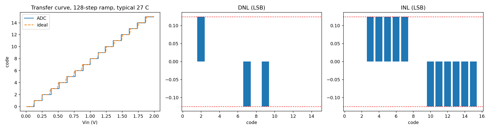

# 4-bit SAR ADC in 180 nm CMOS (GF180MCU): transistor-level design, RTL controller, verification

A 4-bit successive-approximation ADC built from the bottom up: a transistor-level control path (static CMOS gates, master-slave flip-flop, 3-bit FSM), a charge-redistribution capacitor DAC with bottom-plate sampling, and a StrongARM latch comparator, simulated in ngspice with the open GlobalFoundries GF180MCU models. The control logic also exists as verified Verilog that maps onto a Basys 3 FPGA for a bench prototype.

Course project for EEE F376 (Design Project), BITS Pilani, K K Birla Goa Campus, supervised by Ria Rashid. The original Cadence design is not in this repository; everything here runs with open-source tools.

**Status**
- Digital: complete and verified in simulation (RTL, gate-level cross-check, post-synthesis) and by formal proof.
- Analog: complete in simulation (typical, corners, mismatch, dynamic test). Not done: layout and Cadence gpdk180 reruns (see [Not verified](#not-verified)).
- FPGA: Vivado script and constraints are provided but **have not been run**.

## How it works

One conversion takes six clocks (S0 sample, S1..S4 test bit 3 down to bit 0, S5 end of conversion), so 120 ns at the simulated 50 MHz clock (8.33 MS/s).

```
 Vin --[S/H, bottom-plate TG]--> binary cap array (1,2,4,8 C + 1 C) --top plate--> StrongARM comparator + SR latch
                                      ^  bottom plates -> VREF / GND                       |
                                      |                                                    v comp
                      DAC code = R | SET  <----- SAR register (R3..R0) <----- control FSM (S0..S5) -- sample, SET lines, EOC
```

Charge-redistribution decision: `Vin * Ctot > Vref * sum(b_i C_i)`. The top-plate parasitic cancels out of the decision.

## Repository layout

| Path | Contents |
|---|---|
| `rtl/sar_ctrl.v` | 4-bit controller (corrected FSM, SAR register, clock enable) |
| `rtl/sar_ctrl_n.v` | Same controller generalised to N bits |
| `rtl/sar_gates.v` | Gate-level mirror of the transistor-level logic in `spice/cells.sp`, used for cross-checking |
| `rtl/fpga_top.v`, `fpga/` | Basys 3 top level, constraints, batch Vivado script (`build.tcl`, not run) |
| `tb/` | Self-checking testbenches |
| `layout/` | Layout flow on the foundry device generators: inverter, rule subset, LVS (work in progress) |
| `formal/` | SymbiYosys proofs of the controller (`make formal`) |
| `spice/` | Transistor-level netlists: `cells.sp` (gates, DFF, FSM logic), `adc_130b.sp` (complete converter), FSM variants, generators |
| `scripts/` | Run, Monte Carlo and analysis scripts |
| `results/` | All numbers and plots quoted below (JSON, Markdown, PNG) |

## Results

### Digital (Icarus Verilog, Verilator, Yosys)

| Check | Result |
|---|---|
| `tb_sar`: 65 conversions, 64-step ramp plus 1.30 V | 0 errors; 1.30 V gives 1010 |
| `tb_sar_n` for N = 4, 8, 10 (4 steps per code) | 0 errors; all 16 / 256 / 1024 codes reached |
| RTL vs gate-level mirror of the transistor logic | 20,002 random-comparator cycles, 3,332 conversions: identical outputs |
| Post-synthesis netlist (Yosys generic gates) | 65 conversions, 0 errors |
| Lint (Verilator -Wall) | clean (FPGA top: only an initial-value style warning) |
| Yosys, Artix-7: controller alone | 14 flip-flops, 15 LUTs |
| Yosys, Artix-7: `fpga_top` (adds clock divider and synchroniser) | 26 flip-flops, 17 LUTs, 3 CARRY4 |

Run everything with `make digital`.

**Finding.** The two implementations agree on every reachable state but recover differently from the unused state codes. The RTL sends 110 and 111 straight to S0; the transistor-level equations send 110 to S5 (EOC) and 111 to 100. Both are back in S0 within a few cycles.

### Analog (ngspice 47, GF180MCU models, 3.3 V devices run at VDD = 2 V)

| Experiment | Result |
|---|---|
| FSM as built (equations from the reference report) | State sequence 001, 010, 011, 100, 101, 010, ... : S5 goes to S2, S0 and S1 never recur (confirms the report) |
| FSM as built with 1 kOhm on Q_b | Frozen at 111 (confirms the report) |
| FSM corrected (D1 = Q2'(Q1 xor Q0), sync reset) | 000..101, repeating every 120 ns |
| Complete converter, Vin = 1.30 V | code 1010 (10), as in the hand calculation |
| Ramp, 128 steps | 16/16 codes, monotonic, DNL and INL within 0.125 LSB (the step size) |
| Ramp, 256 steps (1/16 LSB resolution) | max abs DNL 0.125 LSB, max abs INL 0.125 LSB, best-fit INL 0.11 LSB; transitions drift down to -0.125 LSB at the top codes (a small gain error) |
| Sine input, 13 cycles in 128 samples (fin 0.85 MHz, fs 8.33 MS/s) | SNDR 25.6 dB, ENOB 3.97, SFDR 34.6 dB; an ideal 4-bit quantiser on the same input gives about 26.0 dB / 4.02 ENOB |
| Comparator offset Monte Carlo, 200 seeds | sigma 7.2 mV, mean -0.3 mV, range -17.5 to +22.5 mV (LSB/2 = 62.5 mV) |
| D flip-flop timing (typical, 20 fF load) | setup 160 ps, hold -160 ps (20 ps scan step), clock-to-Q 280 ps rising / 276 ps falling |

Flip-flop timing note: a hold time of -160 ps with a setup time of +160 ps means the effective sampling instant sits 160 ps before the clock edge and the aperture is near zero (within the 20 ps scan step).




**PVT sweep.** 64-step ramp (0.25 LSB per step) at 11 corner, temperature and supply combinations (Vref and Vcm follow VDD):

| corner | T (C) | VDD (V) | codes seen | monotonic | steps with code error | max code error (LSB) |
|---|---|---|---|---|---|---|
| tt | 27 | 2.0 | 16/16 | yes | 1 | 1 |
| tt | -40 | 2.0 | 16/16 | yes | 1 | 1 |
| tt | 125 | 2.0 | 16/16 | yes | 0 | 0 |
| tt | 27 | 1.8 | 16/16 | yes | 1 | 1 |
| tt | 27 | 2.2 | 16/16 | yes | 0 | 0 |
| ff | 27 | 2.0 | 16/16 | yes | 0 | 0 |
| ss | 27 | 2.0 | 16/16 | yes | 3 | 1 |
| fs | 27 | 2.0 | 16/16 | yes | 3 | 1 |
| sf | 27 | 2.0 | 16/16 | yes | 0 | 0 |
| ss | 125 | 1.8 | 16/16 | yes | 3 | 1 |
| ff | -40 | 2.2 | 16/16 | yes | 2 | 1 |

No corner loses a code or becomes non-monotonic. A "step with code error" means a transition sits more than about 1/8 LSB from ideal; the worst case is three steps in the upper codes. Full table in [`results/pvt_ramp64.md`](results/pvt_ramp64.md).

**Capacitor mismatch** (behavioural Monte Carlo of the binary-weighted array, 5,000 trials per point). The netlist uses ideal capacitors, so the unit-cap sigma below is an **assumption, not a PDK result**:

| unit-cap sigma | worst DNL, median / 99th pct (LSB) | yield, DNL < 0.5 LSB |
|---|---|---|
| 0.5 % | 0.018 / 0.051 | 100 % |
| 1 % | 0.035 / 0.098 | 100 % |
| 2 % | 0.070 / 0.203 | 100 % |
| 5 % | 0.172 / 0.488 | 99.1 % |

At 4 bits, capacitor matching is not the limiting error; comparator offset and the gain drift above matter more.

### Formal proof of the controller

The simulations above test chosen stimuli. The proofs in `formal/` (SymbiYosys, Z3 and ABC PDR) cover every input sequence. Each runs as bounded model checking to depth 40 and as an unbounded proof:

| Check | What is proven | Result |
|---|---|---|
| `ctrl` | Only states S0..S5 are reachable (110 and 111 never occur); `sample` and `eoc` are never high together; exactly one SET line at a time; state steps S0 to S5 and back to S0 on each clock enable; reset clears the state and registers; at S5 the register holds exactly the four comparator decisions; `dout` changes only when the end-of-conversion state is clocked | proven |
| `adc` | With an ideal comparator and DAC, for any constant 4-bit input and free reset and clock enable, `dout` equals the input code after every completed conversion | proven (all 16 codes) |
| `equiv` | The RTL controller and the gate-level mirror of the transistor-level logic have identical `sample`, `eoc` and `dac` outputs for any comparator sequence after power-on | proven |

The checks were mutation-tested: inverting the comparator polarity or skipping a state makes them fail. They do not cover the stale-register and unused-state differences between the RTL and the gates, which only appear after a mid-run reset or an injected illegal state and are described above.

### Layout (started: one cell)

`layout/` holds a Python layout flow built on the foundry's own GF180MCU device generators (NMOS, PMOS and MIM capacitor), run through the standalone `klayout` Python module. So far one cell is drawn, the inverter `INV` (W = 2 um, L = 0.28 um, as in `spice/cells.sp`), with its gate contact, rails, and substrate and well taps (`layout/inverter_layout.png`, `layout/inverter.gds`).

| Check | Result |
|---|---|
| Rule subset (`drc_lite.py`, 33 rules for COMP, poly, implants, n-well, contacts and Metal1, with values from the GF180MCU Design Manual section 7) | 0 violations |
| Layout versus schematic (`lvs_lite.py`, KLayout netlist extraction and comparison, pins checked at their Metal1 shapes) | match |
| Deliberate defects (cut drain strap, missing gate contact, cut supply strap, missing well or substrate tap contact) | each one is caught |

Limits: this is **not** the foundry signoff deck (that needs KLayout's Ruby engine), only the rules listed in `drc_lite.py`; the rest of the converter (other gates, flip-flop, capacitor array, comparator, routing) is not laid out yet, and no parasitics were extracted or simulated. Run it with `python layout/inverter.py` (needs `pip install klayout` and the PDK checkout).

## Reproduce

```bash
# digital (needs Icarus Verilog; Verilator and Yosys optional)
make digital

# analog (needs ngspice >= 42, the GF180MCU models, and Python with numpy + matplotlib)
git clone --depth 1 https://github.com/google/globalfoundries-pdk-libs-gf180mcu_fd_pr ../tools/globalfoundries-pdk-libs-gf180mcu_fd_pr
pip install -r requirements.txt
scripts/setup_spice.sh                               # copies netlists to build/spice, points models.sp at the PDK
(cd build/spice && ngspice -b adc_130b.sp)           # one 1.30 V conversion, ~10 s
python scripts/analyze_fsm.py                        # FSM variants
python scripts/run_batch.py pvt -j 5                 # 11 corner runs, roughly 5 min of CPU each
python scripts/run_batch.py enob -j 1                # sine test, roughly 10 min
python scripts/run_batch.py fine -j 4                # 256-step ramp
python scripts/mc_comparator.py 200 -j 4             # offset Monte Carlo
python scripts/dff_timing.py                         # setup / hold / clock-to-Q
python scripts/mc_cap_dac.py 5000                    # capacitor mismatch (behavioural)
python scripts/analyze.py pvt && python scripts/analyze.py enob && python scripts/analyze.py fine && python scripts/analyze.py plots
```

For the formal proofs, install SymbiYosys with Z3 and run `make formal`.

Set `GF180_MODELS` to use a PDK checkout in another location. The 128-step ramp (`spice/adc_rampb.sp`) takes 10 to 15 minutes.

## Not verified

- **Layout and parasitics.** Only the inverter is laid out (see Layout above). The converter as a whole has no layout, signoff DRC, LVS or parasitic extraction; the only parasitic simulated is a 20 fF top-plate capacitor.
- **Cadence gpdk180.** The original course PDK was not available here; all numbers come from the open GF180MCU models.
- **Capacitors are ideal** in the netlist, and the sine test uses a clean source (no clock jitter, no input noise).
- **Mismatch covers threshold voltage only**, as modelled per device in the PDK (`delvto`); mismatch was not combined with the corner sweep.
- **Noise** (kT/C, comparator) was not simulated.
- **Vivado and hardware.** `fpga/build.tcl` and the R-2R / LM393 bench setup are untested. The Yosys utilisation numbers above are the only FPGA evidence.
- The decoder output glitches and the missing EOC re-timing (open issue 3 of the report) are not fixed.

## License

Apache-2.0, see [LICENSE](LICENSE). Copyright 2026 Prathik Amte.

## References

- GlobalFoundries / Google, GF180MCU open-source PDK, https://github.com/google/globalfoundries-pdk-libs-gf180mcu_fd_pr (Apache-2.0)
- McCreary and Gray, "All-MOS Charge Redistribution Analog-to-Digital Conversion Techniques, Part I", IEEE JSSC, 1975
- Razavi, "The StrongARM Latch", IEEE Solid-State Circuits Magazine, 2015
- The FSM state assignment and equations come from a Master's project report on an ADC in Cadence Virtuoso (Mohammed V University, 2025-26); the S5 -> S2 error in those equations is documented and fixed here.
